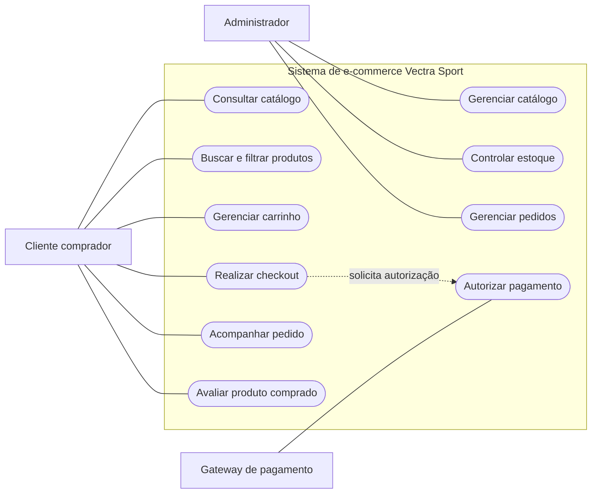
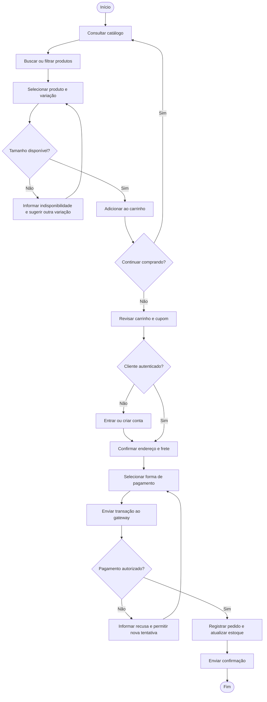

# Especificação e prototipagem de uma plataforma web de e-commerce para a Vectra Sport

**Autores:** [inserir nomes]  
**Instituição:** [inserir instituição]  
**Curso:** [inserir curso]  
**Orientador(a):** [inserir nome]  
**Ano:** 2026

> Documento-base do TCC. Os dados de pesquisa abaixo foram transcritos do roteiro fornecido pelo autor. Completar as informações institucionais, citações, referências e evidências da pesquisa antes da entrega acadêmica.

## Resumo

Este trabalho apresenta a especificação e a prototipagem de uma plataforma web de comércio eletrônico para a Vectra Sport, empresa de pequeno porte atuante no varejo regional de artigos esportivos. O projeto parte de problemas operacionais relacionados à sincronização do inventário e a dificuldades na jornada de compra digital. A pesquisa foi conduzida em caráter aplicado, exploratório e descritivo, articulando questionário online com 120 praticantes de atividades físicas e entrevistas semiestruturadas com oito clientes assíduos e três colaboradores da gestão, conforme os dados fornecidos para este trabalho. Os resultados informados apontaram a relevância de filtros por modalidade (82%), consulta de medidas (74%), checkout com menos de três etapas (91%) e navegação iniciada em smartphones (88%). Com base nesses insumos, foram especificados requisitos funcionais e não funcionais, modelado o caso de uso de checkout e o fluxo de compra, e desenvolvido um protótipo navegável de loja virtual com catálogo, busca, filtros, guia de tamanhos, carrinho, fluxo demonstrativo de checkout e painel administrativo de estoque. O protótipo permite avaliar a organização das interfaces e a jornada proposta, mas não processa pagamentos, calcula frete real nem sincroniza estoque com sistemas de produção. Conclui-se que os artefatos produzidos oferecem uma base rastreável para implementação futura, condicionada à validação dos requisitos, à integração com serviços reais e à avaliação de usabilidade e desempenho.

**Palavras-chave:** comércio eletrônico; engenharia de requisitos; experiência do usuário; varejo esportivo; prototipagem.

## 1 Introdução

O ecossistema do comércio eletrônico tem passado por expansões estruturais significativas, impulsionadas pela aceleração do consumo digital e pela busca por conveniência. No segmento especializado de vestuário e artefatos esportivos, essa dinâmica exige que as empresas evoluam de modelos exclusivamente físicos para operações digitais integradas aos seus processos comerciais. A Vectra Sport, uma pequena empresa atuante no varejo regional, identificou a necessidade de modernizar suas operações por meio de uma plataforma web proprietária para venda direta ao consumidor.

Nesse contexto, define-se o seguinte problema de pesquisa: **de que maneira a especificação e a prototipagem de uma plataforma web de e-commerce, fundamentadas em engenharia de requisitos e design centrado no usuário, podem apoiar a redução de gargalos de inventário e a melhoria da jornada de compra da Vectra Sport?** A formulação enfatiza o apoio potencial da solução, uma vez que os efeitos sobre estoque e conversão dependem de implementação, integração e avaliação em produção.

A relevância do projeto está relacionada à possibilidade de organizar a experiência de compra digital e oferecer à empresa uma especificação rastreável para futura integração dos canais de venda. Também se busca fornecer uma base de solução escalável, acessível e segura, considerando os limites de escopo e os recursos de uma pequena empresa.

### 1.1 Objetivos

O objetivo geral é projetar, modelar e documentar a arquitetura funcional de um sistema web de e-commerce para a loja de roupas esportivas Vectra Sport, abrangendo o perfil dos usuários, os requisitos e os principais artefatos comportamentais e de interface.

São objetivos específicos:

1. Investigar jornadas, hábitos e dificuldades de pessoas que compram artigos esportivos.
2. Especificar os requisitos funcionais e não funcionais da solução.
3. Elaborar modelos de casos de uso e fluxogramas de navegação e processo.
4. Prototipar as principais interfaces da loja virtual e do painel administrativo.

### 1.2 Delimitação

O escopo deste trabalho compreende pesquisa, especificação, modelagem e prototipagem visual e interativa. O workspace inclui integração de backend preparada para criar preferências do Mercado Pago Checkout Pro, condicionada a credenciais de teste e à tarifa de frete configurada pelo lojista. Não constitui um sistema comercial pronto para produção: ainda não há autenticação real, base persistente de pedidos e estoque, cotação dinâmica de frete por CEP, webhook de pagamento verificado, envio de e-mail ou sincronização com loja física. A transação externa não foi testada neste ambiente.

## 2 Metodologia

A pesquisa caracteriza-se como aplicada, exploratória e descritiva, apoiada em práticas de Engenharia de Software e Interação Humano-Computador. O processo foi organizado em etapas de pesquisa com usuários, levantamento e especificação de requisitos, modelagem comportamental e prototipagem de interfaces.

### 2.1 Pesquisa com usuários

A coleta de dados combinou abordagem quantitativa e qualitativa. A etapa quantitativa consistiu em questionário estruturado online aplicado a 120 praticantes de atividades físicas. A etapa qualitativa envolveu entrevistas semiestruturadas com oito clientes assíduos e três colaboradores ligados à gestão da Vectra Sport, conforme a consolidação apresentada no roteiro do projeto.

Os resultados quantitativos fornecidos para o estudo indicam que 82% dos respondentes consideram essencial filtrar produtos por modalidade esportiva; 74% apontam a consulta facilitada à tabela de medidas como fator importante para reduzir a incerteza na compra; e 91% preferem um checkout com menos de três etapas. O levantamento também registra que 88% das compras se iniciam por smartphones. A análise qualitativa identificou dificuldades para localizar produtos por esporte, incerteza de tamanho, lentidão percebida no pagamento, custo do frete, falta de sincronização do estoque físico com as vendas online e atrasos no despacho.

**Tabela 1 — Consolidação da amostra e necessidades relatadas**

| Perfil investigado | Amostra informada | Necessidades ou dificuldades | Implicação para o projeto |
|---|---:|---|---|
| Consumidores finais (praticantes de atividades físicas) | 120 respostas | Incerteza quanto ao tamanho; lentidão no pagamento; frete elevado | Guia de medidas, informações transparentes e fluxo de checkout simplificado |
| Clientes assíduos | 8 entrevistados | Dificuldade de localizar peças por modalidade esportiva | Categorização por esporte e atributos do tecido |
| Colaboradores da gestão | 3 colaboradores | Estoque físico sem sincronização com vendas online; atrasos no despacho | Painel administrativo e especificação de inventário e pedidos |

*Fonte: dados fornecidos pelo autor para este trabalho (2026).*

A amostra, o instrumento e os percentuais são tratados aqui conforme o roteiro recebido. Para a versão final, devem ser descritos o período de coleta, o método de recrutamento e amostragem, as perguntas aplicadas, as características demográficas relevantes, o tratamento dos dados e os procedimentos de consentimento e ética adotados.

### 2.2 Levantamento e especificação de requisitos

Os requisitos foram derivados das necessidades atribuídas à pesquisa e das reuniões de alinhamento com a empresa. A especificação usa identificadores estáveis e prioridade para facilitar rastreabilidade entre problema observado, comportamento esperado e módulo do sistema. As prioridades são classificadas como Essencial, Importante ou Desejável.

### 2.3 Modelagem e prototipagem

A modelagem comportamental delimita os atores Cliente, Administrador e Gateway de Pagamento e descreve as interações esperadas com o sistema. O processo de compra é representado desde a consulta do catálogo até a confirmação do pedido, incluindo decisões de autenticação, disponibilidade de estoque e autorização do pagamento. A prototipagem traduz os requisitos em interfaces para home, catálogo, detalhe de produto, carrinho, checkout e painel demonstrativo de estoque.

## 3 Requisitos do sistema

### 3.1 Requisitos funcionais

Os requisitos funcionais definem ações e comportamentos que a solução deverá oferecer quando implementada.

**Tabela 2 — Matriz de requisitos funcionais**

| Código | Requisito | Descrição | Prioridade |
|---|---|---|---|
| RF-01 | Gestão de catálogo | Permitir cadastrar, editar, inativar e categorizar produtos por esporte, tamanho, cor e marca. | Essencial |
| RF-02 | Busca e filtragem | Permitir busca por palavras-chave e combinação de filtros por preço, tamanho, modalidade e gênero. | Essencial |
| RF-03 | Carrinho de compras | Gerenciar itens, atualização de quantidades, cálculo de frete por CEP e aplicação de cupons. | Essencial |
| RF-04 | Checkout transparente | Fechar pedidos integrado a gateway com cartão de crédito, Pix e boleto. | Essencial |
| RF-05 | Autenticação e perfis | Cadastrar e autenticar clientes e administradores, com recuperação de senha por token enviado por e-mail. | Essencial |
| RF-06 | Controle de estoque | Dar baixa automática no estoque após a confirmação do pagamento. | Essencial |
| RF-07 | Acompanhamento de pedidos | Exibir status do pedido: pagamento aprovado, em separação, enviado e entregue. | Importante |
| RF-08 | Avaliação de produtos | Permitir que cliente autenticado que comprou o produto atribua nota de 1 a 5 estrelas e comentário. | Desejável |

### 3.2 Requisitos não funcionais

**Tabela 3 — Especificação dos requisitos não funcionais**

| Código | Categoria | Especificação | Prioridade |
|---|---|---|---|
| RNF-01 | Desempenho | O carregamento das páginas de catálogo não deve exceder 2,0 segundos em conexão 4G definida como referência de teste. | Essencial |
| RNF-02 | Segurança | As comunicações devem usar HTTPS com TLS 1.3; dados sensíveis de pagamento não devem ser armazenados no banco de dados local. | Essencial |
| RNF-03 | Usabilidade e design | Interface responsiva, mobile-first, adaptada de 320 px a 4K. | Essencial |
| RNF-04 | Disponibilidade | Disponibilidade mensal mínima de 99,5%, a ser comprovada após implantação. | Importante |
| RNF-05 | Conformidade legal | Tratamento de dados pessoais conforme a Lei Geral de Proteção de Dados (LGPD). | Essencial |

Os requisitos RNF-01, RNF-02 e RNF-04 precisam de critérios de medição, ambientes de teste e responsabilidades operacionais detalhados antes da implementação. O protótipo estático não permite comprovar tais métricas. A duração de uma tarefa de checkout, se medida em teste de usabilidade, não é evidência do tempo de carregamento definido em RNF-01.

## 4 Modelagem e desenvolvimento do protótipo

### 4.1 Atores e casos de uso

Os atores externos são o Cliente Comprador, o Administrador e o Gateway de Pagamento. O Cliente consulta o catálogo, pesquisa e filtra produtos, gerencia o carrinho, fecha pedidos, acompanha entregas e avalia produtos comprados. O Administrador mantém catálogo e estoque e acompanha pedidos. O Gateway autoriza ou recusa transações. A fonte Mermaid editável dos diagramas está em [diagramas.md](diagramas.md).

**Figura 1 — Diagrama de casos de uso**

*Fonte: elaborado pelo autor (2026).*

### 4.2 Especificação do caso de uso UC03

**Tabela 4 — Caso de uso UC03: realizar checkout e fechar pedido**

| Campo | Especificação |
|---|---|
| Atores | Cliente Comprador (principal); Gateway de Pagamento (secundário). |
| Pré-condições | Cliente autenticado; carrinho com pelo menos um item cuja disponibilidade foi validada. |
| Gatilho | Cliente seleciona “Finalizar compra” no carrinho. |
| Fluxo principal | 1. O cliente acessa o carrinho e seleciona “Finalizar compra”. 2. O sistema solicita confirmação do endereço e do tipo de frete. 3. O cliente escolhe Pix, cartão de crédito ou boleto. 4. O sistema envia a transação ao gateway. 5. O gateway retorna autorização. 6. O sistema registra o pedido, atualiza o estoque conforme a regra transacional definida e envia confirmação por e-mail. |
| Fluxo alternativo A1 — pagamento recusado | O sistema informa a recusa e permite selecionar outra forma de pagamento, preservando os itens do carrinho e revalidando sua disponibilidade. |
| Pós-condições | Pedido registrado com status correspondente ao retorno do gateway; estoque e histórico atualizados sem duplicidade. |

A atualização de estoque precisa ser atômica ou protegida contra concorrência para evitar venda acima do disponível. Recomenda-se definir também o tratamento de pagamento pendente, cancelamento, expiração de Pix/boleto, falha de comunicação e reembolso.

### 4.3 Fluxo de compra

**Figura 2 — Fluxo do processo de compra**

*Fonte: elaborado pelo autor (2026).*

### 4.4 Interfaces prototipadas

O protótipo navegável disponibilizado em [index.html](../index.html) apresenta as seguintes telas e interações:

- **Página inicial:** marca, campanha visual, atalhos por modalidade, produtos em destaque e acesso ao guia de tamanhos.
- **Catálogo:** busca por texto, filtros por modalidade, ordenação por preço e cartões de produto com preço, categoria, disponibilidade visual e acesso aos detalhes.
- **Detalhe do produto:** seleção de tamanho com indicação de indisponibilidade e inclusão da variação selecionada no carrinho.
- **Carrinho:** alteração e remoção de quantidades, subtotal, demonstração do cupom VECTRA10 e continuação para o checkout.
- **Checkout:** coleta e validação dos dados necessários, seguida da criação de preferência no backend e redirecionamento ao Mercado Pago quando `MP_ACCESS_TOKEN` e `SHIPPING_COST_BRL` estiverem configurados. A conta, os meios de pagamento e as URLs públicas precisam ser configurados pelo lojista.
- **Painel administrativo:** resumo de operação, itens com baixo estoque, variações por tamanho e pedidos fictícios; a ação de reposição altera apenas dados locais do protótipo.

As imagens e dados de produto são exemplos visuais e não representam o catálogo ou inventário real da empresa. O guia de medidas e a indicação promocional também precisam de validação comercial antes de uso público.

### 4.5 Integração com API de pagamento

Para atender ao requisito RF-04, foi preparada uma integração com o Checkout Pro do Mercado Pago usando o SDK oficial para Node.js. O navegador envia ao backend identificadores dos produtos e variações, quantidades, cupom, e-mail e dados de entrega. O servidor valida a entrada, consulta uma lista local de preços demonstrativos e cria uma preferência de pagamento. O cliente é redirecionado ao ambiente hospedado pelo provedor, onde seleciona um meio habilitado para a conta, como Pix, cartão ou boleto (MERCADO PAGO, 2026a; MERCADO PAGO, 2026b).

O Access Token é lido pelo backend a partir da variável `MP_ACCESS_TOKEN`; não é enviado ao frontend. O endpoint bloqueia a criação da preferência se não houver credencial ou valor de frete configurado. Para este protótipo, `SHIPPING_COST_BRL` representa uma tarifa fixa definida pelo responsável da loja, não uma cotação baseada no CEP. As URLs de retorno só são configuradas com domínio público HTTPS, pois o Mercado Pago não aceita `localhost` como retorno (MERCADO PAGO, 2026c, 2026d).

A integração não deve ser considerada uma confirmação de pedido: o retorno do navegador pode indicar um estado, mas a aplicação ainda não possui webhook com validação de assinatura, consulta autoritativa do pagamento, persistência de pedido ou baixa de estoque. Essas etapas devem ser concluídas antes de uma operação comercial. Como Node.js/npm e credenciais do lojista não estavam disponíveis no ambiente de desenvolvimento, o checkout externo não pôde ser executado nem testado aqui.

## 5 Considerações finais

O trabalho organizou uma proposta de e-commerce para a Vectra Sport a partir das necessidades descritas na pesquisa fornecida. Os requisitos funcionais e não funcionais, o caso de uso de checkout, o fluxo de compra, o protótipo de interfaces e a criação de preferência no backend formam uma base documentada para discussão e evolução. A prototipagem torna observáveis decisões de navegação, busca, filtro por esporte, escolha de tamanho, carrinho, checkout hospedado e gestão demonstrativa do inventário.

Os objetivos de especificação, modelagem e prototipagem foram atendidos no escopo deste documento, incluindo a preparação do fluxo de integração com o Mercado Pago. Entretanto, a criação de preferências não foi exercitada com credenciais, e a aplicação não possui webhook verificado nem base de pedidos; portanto, ainda não confirma pagamentos, efetua baixa confiável de estoque ou demonstra uma operação de produção. Também não é possível afirmar que houve redução efetiva de falhas de estoque ou aumento de conversão, pois não foi apresentado estudo comparativo em produção. Os limites de desempenho, segurança, disponibilidade, conformidade e usabilidade dependem de testes próprios e implementação técnica.

Como trabalhos futuros, recomenda-se concluir e validar a integração em ambiente de teste; implementar webhook autenticado, verificação do status junto ao provedor e persistência transacional de pedidos; integrar catálogo e estoque com o sistema utilizado pela loja; substituir a tarifa fixa por cotação de frete e política aprovadas pela empresa; implementar acompanhamento de pedidos e notificações; realizar testes de acessibilidade, segurança, desempenho e usabilidade; e avaliar os resultados com indicadores definidos antes e depois da implantação. Uma recomendação personalizada por inteligência artificial ou aplicativo móvel nativo pode ser considerada posteriormente, após disponibilidade de dados adequados, consentimento e avaliação de viabilidade.

## Referências

**Completar com as fontes efetivamente consultadas**, seguindo as normas bibliográficas exigidas pela instituição. Incluir fontes para Engenharia de Software, Interação Humano-Computador, UML, LGPD, comércio eletrônico e metodologia de pesquisa. Não inserir referências que não tenham sido consultadas.

MERCADO PAGO. *Checkout Pro: criar e configurar uma preferência de pagamento*. Documentação para desenvolvedores. Disponível em: https://www.mercadopago.com.br/developers/pt/docs/checkout-pro-preferences/create-payment-preference. Acesso em: 9 out. 2026.

MERCADO PAGO. *Checkout Pro: configurar URLs de retorno*. Documentação para desenvolvedores. Disponível em: https://www.mercadopago.com.br/developers/pt/docs/checkout-pro-preferences/configure-back-urls. Acesso em: 9 out. 2026.

MERCADO PAGO. *Checkout Pro: configurar notificações de pagamento*. Documentação para desenvolvedores. Disponível em: https://www.mercadopago.com.br/developers/pt/docs/checkout-pro-preferences/payment-notifications. Acesso em: 9 out. 2026.

MERCADO PAGO. *Mantenha suas credenciais seguras*. Documentação para desenvolvedores. Disponível em: https://www.mercadopago.com.br/developers/pt/docs/checkout-pro-preferences/best-practices/credentials-best-practices/secure-credentials. Acesso em: 9 out. 2026.

## Pendências para a versão de entrega

1. Inserir nomes, instituição, curso, orientação, cidade e elementos pré-textuais exigidos.
2. Incluir citações no texto e referências bibliográficas verificáveis segundo a norma solicitada pela instituição.
3. Documentar instrumento, período, recrutamento, perfil da amostra, análise e consentimento da pesquisa.
4. Confirmar com a empresa as regras de estoque, frete, troca, pagamento, pedido e acesso administrativo.
5. Registrar evidências dos testes de usabilidade antes de afirmar o tempo de 45 segundos e definir tarefas, participantes e protocolo.
6. Não associar o tempo de conclusão do checkout ao requisito RNF-01, que especifica carregamento de página.
7. Validar os percentuais da pesquisa e anexar instrumento ou evidências conforme orientação acadêmica e consentimento dos participantes.
