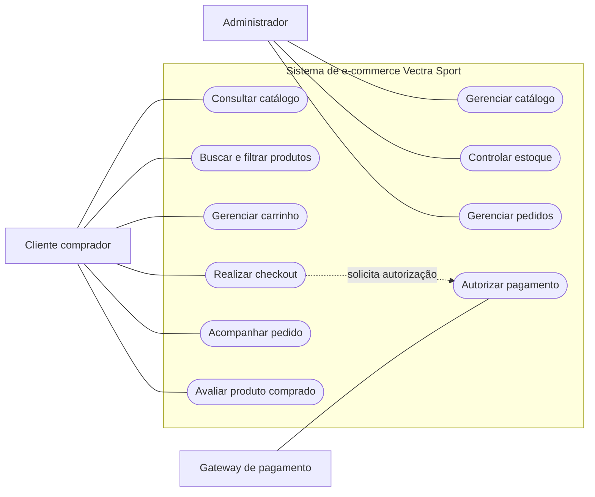
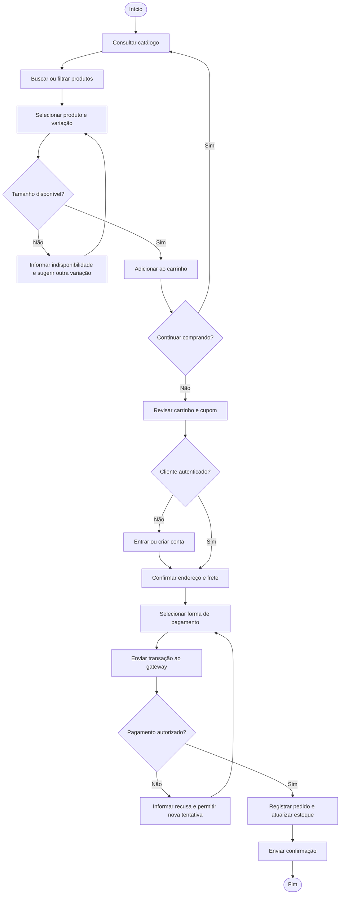

# Diagramas do sistema Vectra Sport

Os diagramas são fontes Mermaid editáveis. A renderização depende de um visualizador compatível com Mermaid.

## Figura 1 — Casos de uso

## Figura 2 — Fluxograma de compra

**Observação:** os diagramas representam a especificação proposta. A confirmação de pagamento, atualização de estoque e envio de e-mail aparecem como comportamento esperado de uma implementação futura, não como funcionalidades de produção do protótipo estático.
